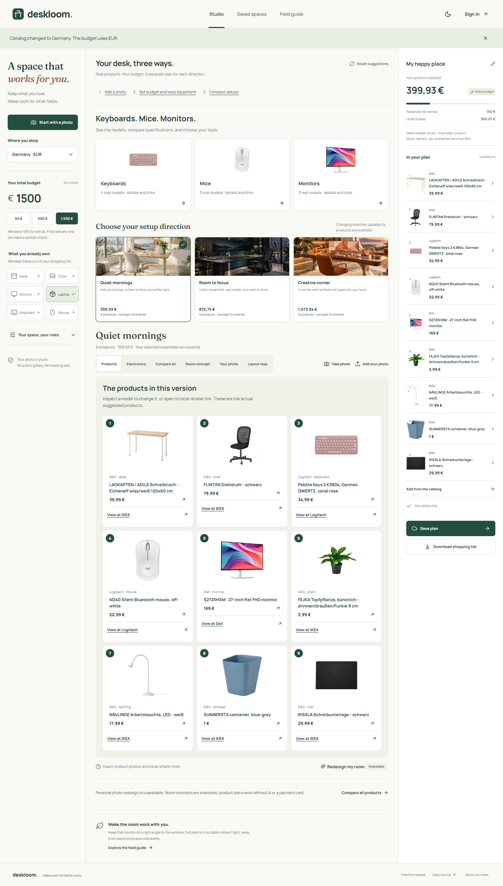
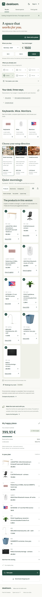
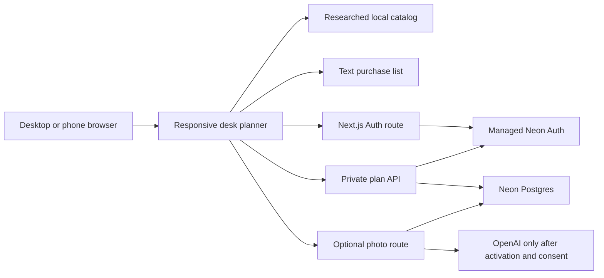

# Deskloom

[](https://github.com/kandulanikhilvarma/deskloom/actions/workflows/ci.yml)
[](LICENSE)

Deskloom helps you plan a better desk with the equipment you own and the budget you have.
Start with a photo, country, and budget. Compare three setup directions.
Explore each suggestion. Change product positions or swap products. Export a shopping list with real retailer links.

[Open Deskloom](https://deskloom.vercel.app) · [Source repository](https://github.com/kandulanikhilvarma/deskloom) · [Release checks](docs/verification.md) · [Deployment guide](docs/deployment.md)

## Release status

The interactive planner works without a cloud account or an image provider.
Private saved plans need active Neon Auth and Postgres services.
Neon contains both application tables. Vercel has encrypted production and preview configuration.
Account services still need public deployment verification.
Neon currently permits password signup without email verification. Email ownership is not verified.
Password recovery and verification email delivery still need an operator acceptance check.
AI photo transformations remain disabled until the owner approves provider costs and supplies an API key.

The public planner is available at [deskloom.vercel.app](https://deskloom.vercel.app).
Desktop and phone guest flows passed on Vercel. Cloud account flows passed against an isolated Neon branch.
See [the activation record](docs/verification.md) before you describe a service as live.

## What users can complete

1. Choose India, the United States, or Germany.
2. Set a budget in the local currency.
3. Mark the equipment to keep.
4. Add a JPG, PNG, or WebP photo, or use the phone camera where the browser supports it.
5. Compare Quiet mornings, Room to focus, and Creative corner.
6. Inspect product specifications, dated prices, retailer links, and compatibility notes.
7. Move a numbered marker or use its position controls.
8. Swap or remove a product within the budget.
9. Export a text shopping list.
10. With active account services, save, reopen, and delete private plans across devices.

The planner reserves 10% of the budget by default for costs that the product subtotal does not cover.
Users can change this reserve. The planner excludes unknown or uncertain prices from automatic product selection.
A small budget can produce free suggestions and no new item.
The interface names missing essentials when the catalog cannot support a complete setup.

## Screenshots

The screenshots show the responsive planner with an illustrative inspiration photo.
The photo does not show the exact products in the shopping list.





## Product boundaries

The maintained catalog contains 36 researched products. India is the first market.
Germany has its own catalog. The euro option does not imply coverage across Europe.
The catalog research checked product references on 16 October 2026.

Prices use dated references. Final tax, delivery charges, stock, and seller terms need a retailer check.
Deskloom does not claim the cheapest seller or predict future sales.

Markers show suggested positions. They do not identify objects in a photo.
The layout map is a schematic and has no verified scale.
Product drawings are category illustrations. Retailer pages contain the actual product details.

The inspiration photo and optional AI output are illustrative.
Exact product appearance, room fit, and electrical compatibility need separate checks.

Comfort guidance cites workstation and eye-care sources.
Deskloom does not diagnose conditions or promise health benefits from a product.
See [research and catalog rules](docs/research.md) for sources and limits.

## Stack

Next.js 16.4.2, React 19.2.4, and TypeScript support one responsive app with private server routes.
Neon supplies managed authentication and Postgres. Vercel hosts the Next.js app.
Zod validates inputs. Node tests cover backend failure paths without real accounts or paid provider calls.

The stack keeps the first release small and lets the web app work on desktop and phone browsers.
The web manifest supports a home screen shortcut. Native iOS and Android apps remain roadmap items.
The app has no offline mode or App Store release.

## Local setup

Use Node.js 22 and npm. Use a separate Neon branch for development data.

```sh
git clone https://github.com/kandulanikhilvarma/deskloom.git
cd deskloom
npm ci
cp .env.example .env.local
npm run dev
```

On PowerShell, use `Copy-Item .env.example .env.local` for the file copy.
Open [localhost:3000](http://localhost:3000).
You can use the planner without secrets. Cloud actions show an unavailable state when their services lack configuration.

### Configuration

Keep every secret on the server. Never use a `NEXT_PUBLIC_` prefix for these values.

| Variable | Purpose |
| --- | --- |
| `DATABASE_URL` | Neon Postgres connection URL for the application server. |
| `NEON_AUTH_BASE_URL` | HTTPS URL of the managed Neon Auth service. |
| `NEON_AUTH_COOKIE_SECRET` | Random secret with at least 32 characters for the Auth SDK. |
| `IMAGE_GENERATION_ENABLED` | Keep `false` until the owner approves image costs and verifies the provider. |
| `OPENAI_API_KEY` | Optional server key for photo transformations. Leave empty when image generation stays inactive. |
| `IMAGE_MODEL` | Optional image model name. The route defaults to `gpt-image-2`. |

The server accepts `COOKIE_SECRET` as a legacy alias for `NEON_AUTH_COOKIE_SECRET`.
Use the documented name for new deployments.
The managed Auth service also needs allowed app origins and a mail provider.
Configure the origins and mail service in Neon.

### Database setup

Run [schema.sql](schema.sql) against the intended development database.

```sh
psql "$DATABASE_URL" -v ON_ERROR_STOP=1 -f schema.sql
```

The schema creates `deskloom_plans` and `deskloom_render_requests` in one transaction.
The script can run again without a second copy of either table.
Do not grant these tables to browser database roles.
See [architecture](docs/architecture.md) for ownership checks and record limits.

## Architecture



The browser holds an unsaved editor photo in memory.
The browser reduces the longest image edge to at most 1400 pixels. It compresses the photo to at most 1 MiB.
A private save sends the photo with its plan to the server.
The server derives the owner from the Auth session. The server ignores client claims about account ownership.
Every read, write, and delete uses the owner ID and the plan UUID.

The first release stores at most 30 plans for each account.
A repeated save updates the same UUID instead of a second record.
List responses omit photo data. A plan detail request restores the private photo.
See [the API and data model](docs/architecture.md) for limits and error behavior.

## Checks

```sh
npm run lint
npm run typecheck
npm test
npm run build
```

For browser checks, start the app, then run `npm run test:browser`.
The local browser configuration uses Microsoft Edge. Override `TEST_BASE_URL` for a deployed guest check.
The account test runs only with `DESKLOOM_AUTH_TEST=true` on the isolated local verification branch.
Never run account fixtures against production.
Use `npm run test:database` with the isolated `DATABASE_TEST_URL` in `.env.test.local`.
The database test also needs `DESKLOOM_INTEGRATION_TESTS=true` in that file.

GitHub Actions runs `npm ci` and these checks for pushes and pull requests.
The build needs no production secrets.
Automated tests use isolated fixtures. They do not establish live email delivery, checkout, stock, or image-provider acceptance.
Browser and production evidence belongs in [the verification record](docs/verification.md).

## Deployment and activation

Use [the deployment guide](docs/deployment.md) for Vercel and Neon setup.
Keep image generation disabled for the first free-tier release.
Approve paid services, third-party legal terms, and live financial transactions before any commitment.
The app has no payment or subscription flow in this release.

## Roadmap

- Exact product image rights and product appearance checks.
- Live retailer feeds, final delivered prices, and more sellers.
- Better product coverage and explicit accessory bundles.
- Calibrated room measurements and richer layout constraints.
- Native mobile apps and offline drafts.
- Shared plans, optional price alerts, and subscriptions after a cost review.

See [CONTRIBUTING.md](CONTRIBUTING.md) for changes and [SECURITY.md](SECURITY.md) for private reports.

## License

Deskloom code uses [Apache License 2.0](LICENSE). Copyright 2026 Nikhilvarma Kandula.
The original inspiration image is illustrative. Product names and retailer marks belong to their respective owners.
Fraunces and Manrope use the SIL Open Font License. Their license files are in `public/fonts`.
Retailer links do not grant rights to copy retailer photographs.

[LinkedIn](https://www.linkedin.com/in/nikhilvarmakandula) · [Email](mailto:kandulanikhilvarma@gmail.com) · [Portfolio](https://kandula.studio)
