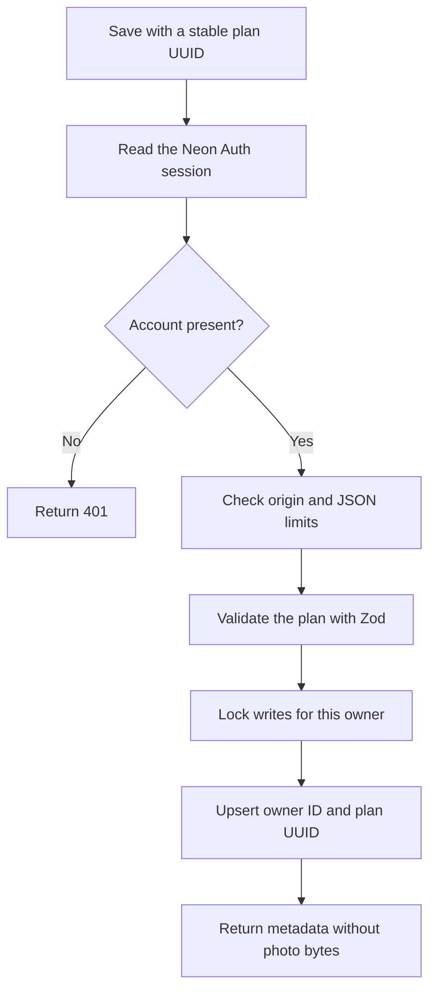

# Architecture and data

## Browser editor

`components/studio.tsx` holds the current plan in browser memory.
`lib/planner.ts` selects products from `lib/catalog.ts` for the market, budget, owned categories, and room constraints.
The planner uses a configurable reserve and excludes products with unknown or uncertain prices.
The editor links each product row to a numbered marker.
The photo preview and layout map share the same selected products.

The upload path accepts JPEG, PNG, and WebP.
The browser reduces the longest edge to at most 1400 pixels and compresses the photo to at most 1 MiB.
The current photo stays in browser memory until a private save or a consented image request.
An unsaved plan does not survive a page reload.
The theme preference does not contain a private plan.

## Private plan flow

`lib/plans/api.ts` handles authenticated list, detail, save, and delete operations.
`lib/plans/store.ts` uses parameterized Neon SQL statements.
The server derives the owner ID from the Auth session for every operation.
Client data cannot select another account owner.
Every query includes the owner ID. The primary key combines the owner ID and plan UUID.
Authorization occurs in server code. The schema does not expose a browser data API.

The save transaction locks writes for one owner before the quota check.
The transaction permits at most 30 records for each account.
A retry with the same UUID updates the existing record.
An identical payload keeps its existing update timestamp.
List responses omit photo bytes. A detail response includes the private photo for the current owner.

## Tables

| Table | Key | Content |
| --- | --- | --- |
| `deskloom_plans` | `owner_id`, `client_id` | Plan JSON, photo data, creation time, update time. |
| `deskloom_render_requests` | `owner_id`, `request_id` | Provider request status and timestamps. |

The plan JSON contains the name, market, currency, budget, mode, owned categories, product IDs, and optional layout.
The plan can also contain notes, room constraints, and a compressed photo.
The database verifies that the JSON ID matches the UUID column.
The schema limits plan JSON to 1,500,000 bytes and revokes public table privileges.
The application database role needs private access to both tables.

## API surface

| Route | Methods | Behavior |
| --- | --- | --- |
| `/api/auth/[...path]` | SDK methods | Same-origin proxy to managed Neon Auth. |
| `/api/plans` | GET, POST | List or upsert the current account's plans. |
| `/api/plans/[id]` | GET, DELETE | Open or delete one plan in the current account. |
| `/api/render` | GET, POST | Report availability or request an optional illustrative image. |

Private responses use `Cache-Control: no-store, private`.
Write requests need the same origin as the app.
Plan JSON has a 1,500,000-byte request limit.
Photos need a valid raster signature and at most 1 MiB of decoded data.
Zod rejects unexpected fields, duplicate products, invalid UUIDs, inconsistent currencies, and positions outside 0–100.
Unavailable services return an error without database URLs or provider secrets.

## Optional image flow

The image feature requires both `IMAGE_GENERATION_ENABLED=true` and `OPENAI_API_KEY`.
The feature also needs authentication, explicit photo consent, and the render request table.
The server reserves the owner and request UUID before a provider call.
The store rejects duplicate UUIDs, a recent active request, or more than 3 requests for the current UTC day.

The provider receives the photo, selected product names, and layout preferences.
The prompt requests preserved room geometry and labels the output as illustrative.
The route limits response size and verifies JPEG output.
The browser displays a successful image without a claim of exact product appearance.

A failed provider call does not trigger an automatic retry.
An uncertain call keeps its request record because the provider can still process it.
The app does not store generated image bytes in the database.
The current generated image disappears when the editor resets or reloads.

## Recovery and deletion

The user can export the current shopping list when cloud services fail.
The editor keeps its current photo after a failed cloud save or image request.
Delete a saved plan to remove its stored photo from the application table.
The Auth provider manages account recovery and account records separately.
The first release has no self-service account deletion or provider retention control.
